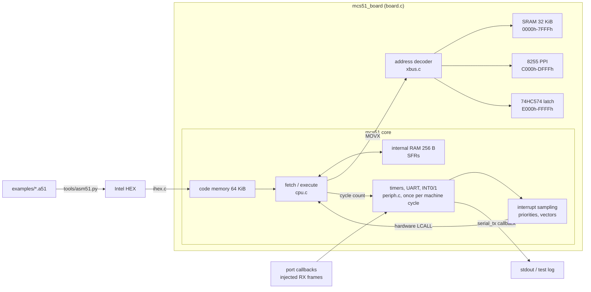

# mcs51-emulator

A cycle-counting Intel 8051 (MCS-51) emulator in portable C11, with a two-pass assembler in Python and the classic 8051 lab exercises as tested example programs.


## Context

This is a self-directed project applying the content of the modules
**Maschinenorientierte Programmierung** (Assembler Programming, B22) and
**Mikroprozessortechnik** (Microprocessor Applications, B28) of the B.Eng.
Technische Informatik – Embedded Systems at BHT Berlin. No 8051 hardware was
used: everything is verified in simulation, against the Intel MCS-51
instruction set documentation and against reference models written in the
tests.

| Module topic | Where it appears in this repository |
|---|---|
| B22: programming model of the 8051, addressing modes | `src/cpu.c` (register banks, bit-addressable area, SFRs, every addressing mode), `tests/test_instructions.c` |
| B22: assembler syntax, machine programming | `tools/asm51.py`, `examples/*.a51` |
| B22: instruction execution and organisation | opcode table with lengths and machine cycles (`src/opcodes.c`), [docs/timing-model.md](docs/timing-model.md) |
| B22 lab: delay loops, function calls, I/O, counters | `examples/delay.a51`, `subroutine.a51`, `port_counter.a51`, `bcd_counter.a51` |
| B22: interrupt, timer and counter programming | `examples/timer0_blink.a51`, `src/periph.c`, `tests/test_interrupts.c`, `tests/test_timers.c` |
| B22: programming the serial interface | `examples/uart_hello.a51`, `examples/uart_echo.a51`, `tests/test_serial.c` |
| B22: machine-level effort of high-level code | `examples/subroutine.a51` (a recursive C function and its cost of 6 + 28 n cycles), the cycle model of `examples/sort.a51` |
| B28: address decoding, memory expansion | `src/xbus.c`, `src/board.c`, [docs/memory-map.md](docs/memory-map.md), `examples/xmem_copy.a51` |
| B28: bus system and timing | `MOVX` bus model: P0 released to `FFh` as address/data bus, P2 latch as page for `MOVX @Ri`, 2 machine cycles per access ([docs/memory-map.md](docs/memory-map.md)); strobe waveforms are not modelled |
| B28: peripheral components (parallel I/O, serial I/O, timer/counter, interrupt controller) | `src/ppi8255.c`, `src/periph.c`, interrupt system in `src/cpu.c` |

## Features

**CPU core** (`src/cpu.c`, `src/periph.c`)

- All 255 defined opcodes with lengths and machine-cycle counts from the
  Intel opcode map (1 machine cycle = 12 oscillator periods). The reserved
  opcode `A5h` is not executed: the core stops with `MCS51_ILLEGAL` and the
  PC pointing at it.
- 256 bytes of internal RAM (upper 128 bytes reachable through `@R0/@R1` and
  the stack, as on the 8052), four register banks, the bit-addressable area
  `20h`-`2Fh` and the bit-addressable SFRs.
- PSW flags `CY`, `AC`, `OV` and `P` as specified for `ADD`, `ADDC`, `SUBB`,
  `DA A`, `MUL`, `DIV`, `RLC`, `RRC`, `CJNE` and the bit instructions.
  `DIV` by zero sets `OV` and leaves `A` and `B` unchanged (Intel: undefined).
- Ports P0-P3 with pull-ups (pin = latch AND external level; P0 is treated
  as if it had external pull-ups) with read and write callbacks; read-modify-write instructions read the
  latch, all others read the pins.
- Timer/Counter 0 and 1 in modes 0-3, `GATE` and counter inputs, ticked once
  per machine cycle.
- Interrupt system with the five sources `EX0`, `ET0`, `EX1`, `ET1`, `ES`,
  two priority levels (`IP`), the fixed polling order, sampling one cycle
  before the poll, `RETI` semantics and the blocking rules after `RETI` and
  writes to `IE`/`IP`.
- Serial port in modes 0-3; in modes 1 and 3 the baud rate comes from timer 1
  overflows (`SMOD` supported). Transmitted frames go to a callback (stdout
  in the CLI); received frames are injected into a queue on the RXD line.
- Idle and power-down modes (`PCON`).

**Lab board** (`src/board.c`, `src/xbus.c`, `src/ppi8255.c`)

- External data memory through a configurable address decoder: 32 KiB SRAM at
  `0000h`-`7FFFh`, an 8255 PPI at `C000h` (mirrored, partial decoding) and a
  write-only 74HC574 output latch at `E000h`.
- The decoder rejects maps that would cause bus contention, and reports mirror
  counts; `mcs51 map` prints the decoding of every address line.

**Tools**

- `tools/asm51.py`: two-pass assembler with labels, `ORG`, `DB`, `DW`, `DS`,
  `EQU`, `DATA`, `IDATA`, `XDATA`, `CODE`, `BIT`, all addressing modes,
  expressions with `HIGH`/`LOW`/`$`, typed symbols (`SETB P1` is an error,
  `SETB P1.0` is meant), Intel HEX and listing output.
- `mcs51` CLI: `run` (with `--max-cycles`, `--clock`, `--trace`, `--ports`,
  `--rx`), `disasm` and `map`.
- Intel HEX loader with checksum and record validation, and a disassembler
  whose output the assembler accepts unchanged.

## Architecture



`mcs51_step()` executes one instruction: its effect is applied, then the
peripherals are clocked once for each of its machine cycles, and the
interrupt poll of the last cycle decides whether the next step is a hardware
`LCALL` to a vector. The details and the deliberate simplifications are in
[docs/timing-model.md](docs/timing-model.md); the external bus and the
decoding logic are in [docs/memory-map.md](docs/memory-map.md).

## Example programs

Each program is in `examples/` with its assembled `.hex` file (committed, and
checked against the source by the assembler tests). `tests/test_examples.c`
runs every one of them on the board and checks results and exact cycle
counts; the counts below are the ones those tests assert.

| Program | What it shows | Checked result |
|---|---|---|
| `delay.a51` | delay loop with a cycle budget | P1.0 toggles every 1000 cycles, 10 times; 10003 cycles in total |
| `subroutine.a51` | recursive subroutine, stack, `MUL` | n! for n = 0..8 in RAM; stack peaks at `79h`; 1176 cycles |
| `port_counter.a51` | polling a button with debouncing | 3 presses counted on P1, a 1000-cycle glitch and contact bounce ignored |
| `bcd_counter.a51` | `ADD` + `DA A`, `MOVC` table lookup | P1 counts 00..99 in BCD, P2 shows 7-segment patterns; 1307 cycles |
| `timer0_blink.a51` | timer 0 mode 1 interrupt, idle mode | P1.0 toggles every 50000 cycles exactly (20 toggles checked) |
| `uart_hello.a51` | UART mode 1, 9600 baud at 11.0592 MHz | `Hello, 8051!` CR LF, frames exactly 960 cycles apart; 13544 cycles |
| `uart_echo.a51` | interrupt-driven receive and transmit, ring buffer | injected text echoed in upper case |
| `xmem_copy.a51` | `MOVX` through the decoder, 8255, latch | block copies verified, checksum `0FD3h` on the 8255 ports; 5034 cycles |
| `sort.a51` | bubble sort with indirect addressing | 16 bytes sorted; 1670 cycles, equal to a model of the algorithm |

## Build and test

Requirements: CMake 3.20+ (for `ctest --test-dir`), a C11 compiler, Python 3.10+
with pytest.

```sh
cmake -S . -B build -DCMAKE_BUILD_TYPE=Release
cmake --build build
ctest --test-dir build --output-on-failure    # 16 CTest tests

python -m pip install pytest
python -m pytest                               # assembler tests
```

Running programs:

```sh
$ ./build/mcs51 run examples/uart_hello.hex
Hello, 8051!
mcs51: halted after 13544 machine cycles (0.014696 s at 11.059200 MHz)
...
$ ./build/mcs51 run examples/timer0_blink.hex --max-cycles 200000 --ports --clock 12000000
[     50029] P1 = FEh
[    100029] P1 = FFh
[    150029] P1 = FEh
mcs51: cycle limit after 200000 machine cycles (0.200000 s at 12.000000 MHz)
...
$ ./build/mcs51 run examples/uart_echo.hex --rx 'hello, 8051\r'
HELLO, 8051
$ ./build/mcs51 disasm examples/sort.hex
$ ./build/mcs51 map
$ python tools/asm51.py examples/sort.a51 -o sort.hex -l sort.lst
```

Program output from the serial port goes to stdout, everything else to
stderr. Exit status: 0 when the program halts, powers down or reaches the
cycle limit, 1 for usage or load errors, 2 for the reserved opcode.

**Windows:** the same commands work with any C11 compiler that CMake finds;
the binaries get an `.exe` suffix. The project was developed on Windows with
zig cc 0.16 (clang) and Ninja; CI builds with GCC on Ubuntu, once normally
and once with AddressSanitizer and UndefinedBehaviorSanitizer.

## Tests

- `test_opcode_table`: length and cycle count of all 256 opcodes against
  matrices transcribed from the Intel opcode map; every opcode is executed.
- `test_alu`: exhaustive `ADD`/`ADDC`/`SUBB` over all operands and carries
  against reference models of CY/AC/OV/P, `DA A` on all decimal sums,
  exhaustive `MUL`/`DIV` (including division by zero), rotates, `CJNE`,
  worked examples from the Intel instruction descriptions, and a table of
  named edge cases (`DA A` after `ADD`, `SUBB` borrow and overflow, `MUL`
  and `DIV` flags).
- `test_instructions`: addressing modes, register banks, bit operations,
  stack, branches, `MOVC`/`MOVX`, port read-modify-write rules, reset values.
- `test_interrupts`, `test_timers`, `test_serial`: interrupt latency and
  priorities, timer modes 0-3, gate and counter input, serial timing in all
  four modes.
- `test_xbus`, `test_ihex`, `test_disasm`: decoder (including its overlap rule
  against a brute-force search over all 64 Ki addresses), 8255, Intel HEX parsing,
  and a round trip of all 256 opcodes between the assembler and the C
  disassembler.
- `test_examples`: the example programs end to end, plus CLI tests in CTest.
- `tests/asm/test_asm51.py`: encodings of every instruction form against
  hand-written opcode bytes, bit and SFR addresses, directives, expressions,
  error messages and the committed HEX files.

On the development laptop (Release build, zig cc 0.16) a busy polling loop
ran at about 72 million machine cycles per second, about 78 times the speed
of a real 8051 at 11.0592 MHz (measured with `mcs51 run` over 200 million
machine cycles; the number depends on the machine).

## Project layout

```
include/mcs51/   public headers: mcs51.h (core), xbus.h, ppi8255.h, board.h, ihex.h
src/             cpu.c, periph.c, opcodes.c, disasm.c, ihex.c, xbus.c, ppi8255.c, board.c, main.c (CLI)
tools/asm51.py   two-pass assembler
examples/        lab programs (.a51) and their assembled images (.hex)
tests/           C unit and end-to-end tests (CTest), testkit.[ch]
tests/asm/       pytest tests for the assembler
tests/vectors/   all-opcodes test vector and its generator
docs/            timing model, memory map and decoding logic
```

## Design notes

- **Instruction-granular timing.** Each instruction's effect is applied at
  once and the peripherals are then clocked once per machine cycle. This keeps
  the core a plain `switch` over opcodes while every cycle count a program can
  observe (delay loops, timer periods, baud rates, interrupt latency) stays
  exact. A state-accurate model (S1P1-S6P2) would only matter for effects
  inside a multi-cycle instruction; the limits are listed in the timing
  document.
- **One opcode table, cross-checked three ways.** `src/opcodes.c` holds length,
  cycles and a disassembly template for each opcode. A test compares it with
  the Intel opcode map, another executes every opcode against it, and the
  disassembler must reproduce `tests/vectors/all_opcodes.a51`, which is
  generated from the assembler's own instruction table. A wrong entry in the
  C table or in the assembler's table fails at least one test.
- **Interrupts sampled per cycle, polled per instruction.** Requests are
  sampled at the end of every machine cycle and polled in the last cycle of
  each instruction using the previous sample, as on the real chip. This is
  what makes a request that arrives in the last cycle of a `MUL` wait one
  more instruction, and it gives the minimum response time Intel specifies:
  3 complete machine cycles from the request to the first instruction of the
  service routine (the polling cycle plus the 2-cycle hardware `LCALL`).
- **Decoder as mask/match pairs.** Each device is described by the address
  lines the decoder compares, their required levels, and the lines wired to
  the device. Mirrors and overlap checks follow directly from these masks, and
  the same description prints the address-line table of `mcs51 map`.
- **Terminating programs.** A jump to itself with no interrupt enabled is
  reported as a halt (after the transmitter has finished), so programs end
  with the usual `SJMP $` and still terminate in tests and on the command line.
- **Typed symbols in the assembler.** `DATA` and `BIT` symbols keep their type,
  so using a byte address where a bit is expected (or the reverse) is an error
  instead of silently wrong code. Generic `JMP`/`CALL` always assemble to the
  3-byte long forms, which keeps instruction sizes known in pass 1 without
  branch relaxation.

## Limitations and next steps

- Not compared against real silicon. The cycle numbers come from the Intel
  instruction set table and the emulator's timing model; running the same
  programs on an 8051 derivative (or in a reference simulator such as ucsim)
  and comparing would be the next validation step.
- Plain 8051 peripherals only: no Timer 2, no other 8052/derivative SFRs, no
  watchdog. Unimplemented SFR addresses read `FFh` and ignore writes.
- The bus is modelled per access: no `ALE`, `/PSEN`, `/RD`, `/WR` waveforms,
  and the P2 pins are not shown carrying `DPH` during `MOVX @DPTR`.
- Serial reception works on whole frames from a queue; noise, framing errors
  and the bit-level majority vote on RXD are not modelled. The 8255 supports
  mode 0 and bit set/reset only.
- The assembler has no macros, conditional assembly, include files or
  relocatable segments, and `EQU`, `ORG` and `DS` cannot use forward
  references.
- Hardware-near C (also part of B22) is not covered yet: a natural extension
  is to run SDCC-compiled programs on the emulator and compare their cycle
  cost with the hand-written assembler versions.

## License

MIT, see [LICENSE](LICENSE).
